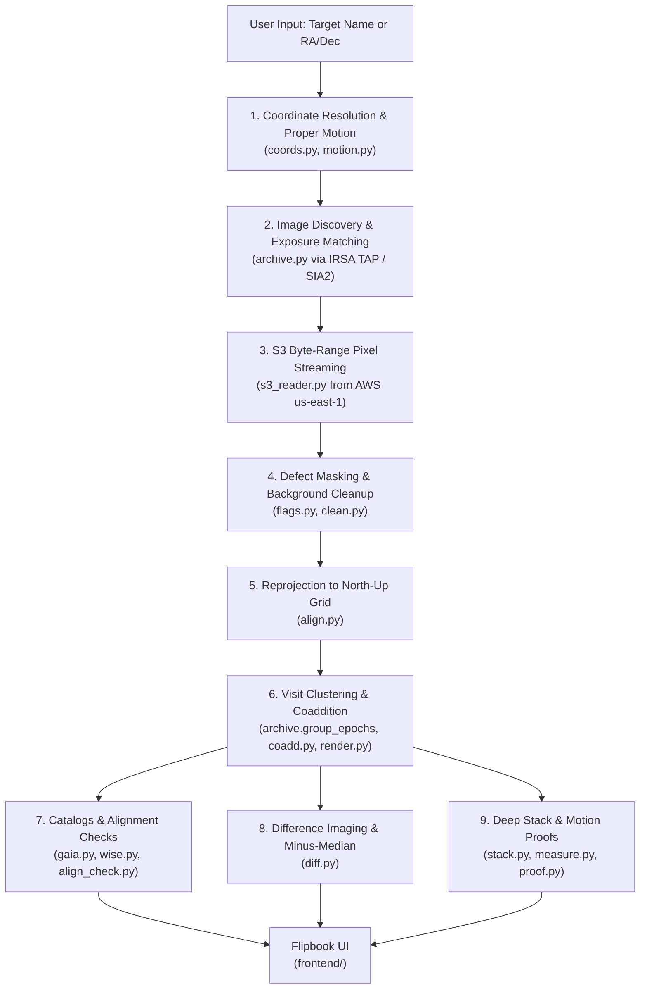

# Data Flow: From Sky Coordinates to Flipbook Frames

How a user query turns into calibrated, time-ordered SPHEREx image frames, difference maps, and astrometric measurements.

---

## Architecture Overview

---

## 1. Coordinate Resolution & Proper Motion (`coords.py`, `motion.py`)

* **Input**: An astronomical name (e.g. `Barnard's Star`, `WISE 0855`) or celestial coordinates (`RA, Dec` in decimal degrees or sexagesimal hours/degrees).
* **Reference Epoch**: SPHEREx began operations in 2025. All target coordinates are moved to epoch **2026.0** using linear proper motion ($\mu_\alpha \cos\delta$, $\mu_\delta$) so the search box is centered on where the object actually is during the mission, not where it was at J2000.
* **Pixel Grid Definition**: A tangent plane (`RA---TAN`, `DEC--TAN`) centered at the 2026.0 target position, oriented north-up and east-left, with SPHEREx's native pixel scale of 6.15 arcsec/pixel. A 3-arcminute field of view gives a compact 29 × 29 pixel array.

---

## 2. Image Discovery & Footprint Search (`archive.py`, `config.py`)

* **Collections**: We search active science releases: `spherex_dr1`, `spherex_dr1_deep`, `spherex_qr3`, and `spherex_qr3_deep`. Earlier internal releases like QR2 are retired.
* **Discovery Protocol**: An ADQL cone query to IRSA TAP (`spherex.obscore`) finds all exposures whose field of view covers the target coordinates.
* **Failover**: If IRSA TAP is slow or returns 502 gateway errors, the search falls back to IRSA SIA2 (Simple Image Access), which returns the matching exposures and public S3 keys. Query results are cached on disk for 1 hour.
* **Visit Grouping**: SPHEREx observes sky patches in clusters. Consecutive exposures taken within 30 days are grouped into a single "visit" (spanning at most 60 days). Long gaps (>30 days) start a new visit epoch.

---

## 3. Cloud Pixel Streaming via S3 Range Requests (`s3_reader.py`)

* Instead of downloading the full 62 MB Level-2 FITS file for each exposure, our S3 reader fetches only the metadata headers and the detector rows covering our target box:
  1. HTTP range request reads the primary and extension headers (first 2880 bytes).
  2. The WCS converts target (RA, Dec) to detector pixel coordinates $(x, y)$. If the target lands outside the 2040 × 2040 active detector, the exposure is skipped immediately with zero pixel data downloaded.
  3. Bounding row indices $[y_0, y_1]$ are calculated.
  4. The reader fetches only those rows from `IMAGE`, `VARIANCE`, `ZODI`, and `FLAGS` in parallel HTTP range requests.
  5. For DR1 and QR3, `FLAGS` rows are compressed with RICE_1 and decoded in memory using astropy's Rice1 codec.
* **Fallback**: If an S3 fetch fails, the pipeline automatically falls back to IRSA's server-side cutout service (`ibe/cutout`), throttled to 3 concurrent requests. Every FITS file records its origin in the `PIXSRC` header (`aws-s3` or `irsa-cutout`).

---

## 4. Calibration, Cleaning & Defect Masking (`clean.py`, `flags.py`)

* **Zodiacal Light Subtraction**: The calibrated surface brightness is `IMAGE - ZODI` in units of MJy/sr.
* **Defect Bitmasking**: Hardware defect bits are parsed dynamically from the FITS header (`MP_*` in older headers, `MSKN*`/`MSKM*` in QR3/DR1). Known problems (`HOT`, `COLD`, `SATURATED`, `TRANSIENT`, `GHOST`) are masked as bad.
* **Crucial Rule on SOURCE**: The `SOURCE` flag (bit 21) marks pixels containing real astronomical catalog sources. It is intentionally kept **unmasked** so real stars and asteroids are never erased as defects.
* **Wavelength Mapping**: SPHEREx uses Linear Variable Filters (LVF), meaning wavelength changes continuously across the focal plane. The reader extracts the `WCS-WAVE` spectral table HDU to determine the exact observed central wavelength and bandwidth at the target pixel.

---

## 5. Reprojection & Visit Coaddition (`align.py`, `coadd.py`, `render.py`)

* Each individual exposure has its own spacecraft roll and pointing center. Exposures are reprojected onto the common north-up 29 × 29 grid using area-weighted flux conservation.
* Within each visit, multiple exposures (typically 8) are stacked using **$1/\sigma^2$ inverse-variance weighting**:
  $$I_{\text{visit}} = \frac{\sum_k w_k I_k}{\sum_k w_k}, \quad w_k = \frac{1}{\sigma_k^2}$$
* This produces:
  * `epoch<i>.fits`: 4-layer FITS file (`IMAGE`, `SIGMA`, `FLAGGED`, `HAS_VALUE`).
  * `epoch<i>.png`: 8-bit grayscale image scaled with `asinh` or linear stretch.
  * `epoch<i>_flags.png`: Semi-transparent red overlay highlighting bad pixels.
  * `manifest.json`: Metadata for every visit (dates, wavelengths, flagged percentage, provenance).

---

## 6. Catalogs & Alignment Checks (`gaia.py`, `wise.py`, `align_check.py`)

* **Gaia DR3 Ground Truth**: Slow-moving stars ($G < 17$, $\mu < 100$ mas/yr) are queried from IRSA TAP `gaia_dr3_source` and propagated to each visit date.
* **Alignment Audit**: We compute the 3 × 3 centroid around each predicted Gaia star position. If the median offset across stars exceeds 0.50 pixels, the visit is flagged with a "possible misalignment" warning. Across all rendered targets, typical offsets are 0.14 to 0.40 pixels.
* **CatWISE2020 Overlays**: Mid-infrared sources from IRSA `catwise_2020` are propagated from reference epoch 2015.4 to each visit date. Proper motion $\mu_\alpha \cos\delta$ is handled in arcsec/year, matching Gaia's physical on-sky velocity.

---

## 7. Difference Imaging & Minus-Median Frames (`diff.py`)

* **Pairwise Differences**: For every visit pair $(A, B)$, the difference map is computed in units of noise $\sigma$:
  $$z = \frac{B - A - \Delta_{\text{sky}}}{\sqrt{\sigma_A^2 + \sigma_B^2}}$$
  where $\Delta_{\text{sky}}$ is the median background change across mutually usable pixels.
* **Colormap**: Saved as `diff_<a>_<b>.png` with a symmetric $\pm 5\sigma$ scale (orange where visit B is brighter, blue where visit B is fainter, transparent on unobserved/bad pixels).
* **Default Pair Selection**: The pair with the **closest target wavelengths** is chosen as the default view to minimize chromatic residuals caused by stellar color differences across the LVF.
* **Minus-Median Frames (WiseView Style)**: When a target has $\ge 2$ visits, we compute the per-pixel median across all visits (`median.fits/png`). Subtracting this median from each visit reveals moving objects and transient flares while removing static stars and background structures.

---

## 8. Deep Stacks & Motion Proofs (`stack.py`, `measure.py`, `proof.py`)

* **Multi-Visit Coaddition (`stack.py`)**: All visits are stacked using $1/\sigma^2$ weighting into `stack.fits`, `stack.png`, and `stack.json`. Noise drops by approximately $1/\sqrt{N_{\text{visits}}}$ (e.g. $1.73\times$ gain for 3 visits, $2.18\times$ for 5 visits), revealing faint objects hidden in single exposures.
* **Proper Motion Verification (`proof.py`)**: Measures target displacement between the earliest and latest visits using brightness centroids (or saturated-core centers for bright stars) and compares against Gaia DR3 predictions. Shifts agreeing within 0.50 pixels confirm proper motion detection.

---

## 9. Web Presentation (`frontend/`)

* The frontend loads `manifest.json`, `diff.json`, `stack.json`, and catalog overlays directly from static folders without backend database overhead.
* Users can step through visits, play at 1–10 FPS, inspect difference maps, toggle Gaia/WISE markers, and click anywhere to convert display pixels directly into celestial coordinates (RA, Dec).
