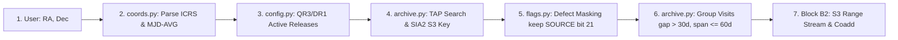

# SPHEREx Data Flow (Block B1)

### Pipeline Steps:
1. **Coordinates (`coords.py`):** Normalizes user input into ICRS degrees and observation `MJD-AVG`.
2. **Collections (`config.py`):** Targets active science releases (`spherex_dr1`, `spherex_qr3`); QR2 is retired.
3. **Archive Search (`archive.py`):** Queries IRSA TAP for footprints covering coordinates (1-hour cache).
4. **AWS S3 Keys (`archive.py`):** Fallback to IRSA SIA2 to extract public S3 keys when `obscore` is blank.
5. **Quality Flags (`flags.py`):** Bitmasks hardware defects (`HOT`, `COLD`, `GHOST`) while keeping `SOURCE` (bit 21) unmasked.
6. **Visits (`archive.py`):** Clusters exposures into observation epochs (gap $> 30\text{d}$, span $\le 60\text{d}$).
7. **Hand-off to B2:** Ready to stream $29 \times 29$ pixel stamps directly from S3, align North-up, and blink.
